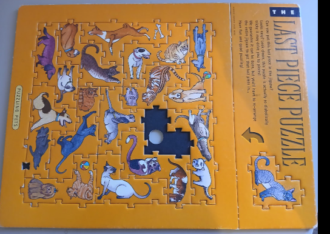

# Last Piece Puzzle Solver

**Solving a frustrating puzzle in two ways:**
- **a brute-force algorithm**
- **a faster way using Exact Cover/'Algorithm X'**

See the [specs](./docs/specs/README.md) for the plan and tests.
Includes a scanner to read in and solve other puzzles in the series.


## Impossible?
As a Christmas present, many years ago, I received *"Puzzling Pets"* - a *"Last Piece Puzzle"*.
The puzzle appears to be simple - just rearrange the pieces to fit. However it proved fiendishly difficult to solve.
Christmases came and went. Family, friends and neighbours struggled.

*Not one of us could solve it.*



Dugald Keith created a series of these in the 1990s and they were sold by Blue Opal. Indiana University has [archived photos of all the series](https://digitalcollections.iu.edu/collections/p2678p93x?utf8=%E2%9C%93&cq=last+piece&sort=&locale=en).


## The first solution - Anton's algorithm
As I suspected, I was not the only one to be frustrated by these puzzles. Eventually,
I came across [a *brute-force* algorithm in C++ by Anton Gerdelan](https://github.com/capnramses/golfing_madness_puzzle_solver). He had had a similar experience with the "Golfing Madness" puzzle in the same series. Thanks to Anton, I finally finished the puzzle. I converted the algorithm to Python, and made a few small improvements, including finding all solutions. See below for details. *All credit for this algorithm goes to Anton.*

Anton's C++ solver ([`cpp/main.cpp`](./cpp/main.cpp), kept unchanged here) is a depth-first search.
It finds the first empty cell in reading order and tries each unused piece there, in each of its
4 rotations, with each of its cells as the one that sits in the gap. A piece fits if it stays on the
board, doesn't overlap another piece, and each of its tabs is the opposite of the tab it touches, on
a neighbour or on the frame. If nothing fits, it takes the last piece back out and tries the next
option.

I made these changes, one step at a time, each with its own spec and tests:

1. **Recorded the C++ answer.** I built and ran Anton's code and saved its solution as a test fixture,
   with its move count (1,529,410) and time (about 1.2 s). Every later step is checked against it
   ([SPEC-0002](./docs/specs/SPEC-0002-record-cpp-solution.md)).
2. **Converted it to Python.** The pointers became immutable dataclasses and a tab `Enum`. The search
   tries the pieces in the same order (N to A) and finds the same first solution at exactly the same
   move ([SPEC-0003](./docs/specs/SPEC-0003-python-port.md),
   [SPEC-0004](./docs/specs/SPEC-0004-solution-and-fit-tests.md)).
3. **Split it into classes:** `Piece`, `PieceSet`, `Board` and `Solver`, with no change to the search
   ([SPEC-0005](./docs/specs/SPEC-0005-object-model.md)).
4. **Made the puzzle an input.** Each puzzle is now a module in `src/last_piece_puzzle/puzzles/`, checked
   when it loads, so the solver can take any puzzle in the series
   ([SPEC-0006](./docs/specs/SPEC-0006-puzzle-definitions.md)).
5. **Found all the solutions.** The C++ stops at the first solution. The Python search carries on and
   finds all 5. Some pieces look the same after a half turn, tabs included (D and H, for example). These
   now try only their different rotations, so each solution is found once, not 4 times
   ([SPEC-0007](./docs/specs/SPEC-0007-all-solutions.md)).
6. **Ran it on all CPU cores.** The search is split into a few thousand small tasks, one for each
   way to place the first pieces, and run in separate processes. On 22 cores this took the full search
   from 14.2 s to about 2.2 s ([SPEC-0008](./docs/specs/SPEC-0008-parallel-search.md)).
7. **Made each step faster** (`--method fastsearch`). Before the search starts, it works out which
   placements fit on the board and against the frame at each cell. During the search, it only checks
   overlap (one AND on a 64-bit mask) and the neighbours' tabs, held as small ints. It tries the same
   placements in the same order, so every move count is unchanged
   ([SPEC-0009](./docs/specs/SPEC-0009-fast-engine.md)).

All 5 Golfing Madness solutions take 1,430,150 moves, in about 1.2 s on 22 cores with
`--method fastsearch`. The original port is still there as `--method search`, and the tests check both
against the C++ answer.


## A New Algorithm: Extended 'Exact Cover' algorithm using bitsets
The depth-first search always fills the next empty cell in reading order, whatever the cost. It
can place many pieces before it finds out that an earlier choice made the puzzle impossible.
Exact cover turns this round: it always works on the cell or piece with the fewest options left.

- **The puzzle as a table.** An exact cover problem is a table of yes/no marks. The aim is to choose
rows so that every column is marked exactly once. Here there is one column for each board cell (64)
and one for each piece (14). There is one row for each way a piece can sit on the board: each
rotation, at each position where it stays on the board and its tabs fit the frame. A row marks the
cells it covers and its own piece. Choosing rows that mark every column once fills every cell once
and uses every piece once. Golfing Madness has 1,419 rows.

- **Adding the tabs.** Plain exact cover knows nothing about tabs. So, before the search starts, each
row gets a list of the rows that clash with it: placements that would touch it with an outey against
an outey, or an inney against an inney.

- **The search (Algorithm X).** Pick the column with the fewest rows left. If it has none, this choice
was a dead end, so go back. Otherwise try each of its rows in turn. Choosing a row removes every row
that overlaps it, reuses its piece, or clashes with its tabs. Repeat on what is left. When no columns
are left, every cell and piece is covered and every tab fits, so it is a solution.

- **Bitsets, not dancing links.** Knuth runs Algorithm X with
'[dancing links](http://arxiv.org/pdf/cs/0011047)': circular doubly linked lists, where choosing a row
unlinks nodes and going back relinks them. The table here is small, so instead each set of rows is a
Python int used as a bitset (bit *i* is row *i*). Choosing a row is one AND of two ints, and counting
a column's rows left is one `bit_count()`. Both run in C, not Python. Going back costs nothing: the
set of rows still possible is a plain int, so each step keeps its own copy.

**The result.** For Golfing Madness, all 5 solutions are found after choosing 19,469 rows, against
about 715,000 pieces placed by the depth-first search:

| Method                | Steps                        | Time (all 5 solutions)     |
|-----------------------|------------------------------|----------------------------|
| `--method search`     | 1,430,150 places and removes | 2.8 s, on 22 cores         |
| `--method fastsearch` | 1,430,150 places and removes | 1.2 s, on 22 cores         |
| `--method exactcover` | 19,469 rows chosen           | 0.1 s, on one core         |

The design and tests are in [SPEC-0010](./docs/specs/SPEC-0010-exact-cover-algorithm.md), and the
code is in [`exact_cover.py`](./src/last_piece_puzzle/exact_cover.py).


## Setting up and running the solver
You need Python 3.14 (may work on other versions) and [uv](https://docs.astral.sh/uv/). uv installs everything else.

```
git clone https://github.com/darrenpaine/last-piece-puzzle.git
cd last-piece-puzzle
uv sync
```

Run the solver. With no puzzle named, it shows a menu of the puzzles it knows:

```
uv run last-piece-puzzle                    # choose from a menu
uv run last-piece-puzzle golfing_madness    # solve one puzzle by its key
uv run last-piece-puzzle --list             # list the puzzles
```

It prints each solution as a grid of piece letters, a key to the letters, and a final line such as
`5 solutions found in 19469 rows chosen, 0.1 s (Algorithm X).`

Exact cover is the default. The two depth-first searches are still there for comparison:

| Option                | What it runs                                                   |
|-----------------------|----------------------------------------------------------------|
| `--method exactcover` | Exact cover (default): well under a second                     |
| `--method fastsearch` | Fast depth-first search: about a second, with all CPU cores    |
| `--method search`     | The original port of Anton's C++: a few seconds                |
| `--workers N`         | Processes for the depth-first searches (default: all CPU cores) |

Each puzzle is a module in `src/last_piece_puzzle/puzzles/` named `<key>_puzzle.py`. Add a file
there and the solver picks it up.


## Running the scanner and creating a puzzle to solve
The scanner turns a photo of a puzzle into a puzzle module. A vision model, Claude or Gemini, reads
the photo and writes a **sheet**: a short text file that lists the frame's tabs, and the cells, tabs
and picture of each piece. The scanner checks the sheet, solves it, and only then writes the module.

1. Install the scanner's extra packages and set an API key for the model you want to use:

   ```
   uv sync --extra scan
   export ANTHROPIC_API_KEY=...    # for Claude (the default), or
   export GEMINI_API_KEY=...       # for Gemini, with --model gemini
   ```

2. Put the photo in `scans/<key>/` (photos are not committed) and run the scanner. Use the option
   that matches the photo:

   ```
   uv run last-piece-scan puzzling_pets scans/puzzling_pets/puzzling_pets.jpg --unsolved
   ```

   | Photo                                               | Option             |
   |-----------------------------------------------------|--------------------|
   | The puzzle as sold: a gap, and the last piece aside | `--unsolved`       |
   | The puzzle solved, every piece in the frame         | (none)             |
   | The loose pieces and the empty frame                | `--pieces`         |

   Add `--model gemini` to use Gemini instead of Claude. Turn the photo upright first, so the top of
   the board is at the top.

3. The model's sheet is saved as `scans/<key>/sheet.txt`. If a check fails, the scanner says which
   cell or line is wrong, for example `cell (0, 2) E east is O and cell (0, 3) H west is O: touching
   tabs must differ`. Fix the sheet against the photo and check it again. This doesn't call the model:

   ```
   uv run last-piece-scan puzzling_pets --sheet scans/puzzling_pets/sheet.txt
   ```

   The scanner never overwrites `sheet.txt`, because it may hold your fixes. It won't replace an
   existing puzzle module unless you add `--force`.

4. When every check passes, it writes `src/last_piece_puzzle/puzzles/<key>_puzzle.py`, and
   `scans/<key>/pieces.txt` as a record. Then solve it:

   ```
   uv run last-piece-puzzle puzzling_pets
   ```

The checks:
- **Edges.** Where two pieces touch, one tab is an outey and the other an inney. The exception is a
  photo of the puzzle as sold: every puzzle comes with exactly one place where two inneys touch,
  between an edge piece and the frame. The scanner lists it, and warns if it finds a different number.
- **Tab balance.** The outeys and inneys must pair up across the whole puzzle. One misread tab
  throws this out.
- **Solve.** The puzzle must have a solution.
- **Pattern.** The tabs mostly follow a checkerboard, where each cell is all outeys or all inneys.
  The deliberate breaks in that pattern are what make the puzzles hard, and they are where misreads
  matter most, so the scanner lists them for you to check against the photo. It also warns when there
  are more than 20 solutions: the puzzles in this series have only a few.

You can also skip the model and write a sheet by hand. `scans/puzzling_pets/sheet_claude.txt` is an
example.


## The process - specification, testing, linting, type checks

See the detailed [SPECS](./docs/specs/README.md). Each spec also details the expected behaviour and the linked tests implemented in the [tests](./tests/) folder. I added a github workflow and a pre-commit check to make sure all tests were run, coverage was good, lint was clean and mypy ran strict checking on all types.
